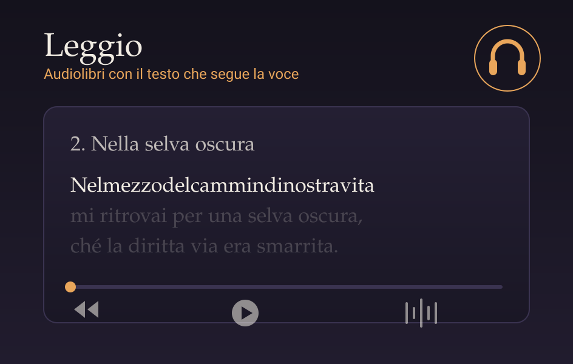

# Matteo Burbui · maxeo

Sviluppatore full stack con esperienza dal 2010, tra software aziendale, web e sistemi Linux. Oggi lavoro in ambito .NET e su agenti AI aziendali. Nel tempo libero progetto oggetti da stampare in 3D e sperimento con la narrativa.

[LinkedIn](https://it.linkedin.com/in/matteo-burbui-667828213) · [Repository](https://github.com/maxeo?tab=repositories)

## Cosa faccio oggi

In **Skynet Technology** mi occupo di sviluppo .NET e di progetti interni con agenti AI per customer care, backoffice e risoluzione di ticket e chiamate.

## Progetti recenti

<table>
<tr>
<td width="33%" valign="top"> <b><a href="https://github.com/maxeo/ultima-alba-di-dalmasca">L'ultima alba di Dalmasca</a></b> Romanzo di fan da <i>Final Fantasy XII</i>, scritto con modelli AI sotto la mia direzione, con <a href="https://maxeo.github.io/ultima-alba-di-dalmasca/">lettore per l'audiolibro</a>. Opera non ufficiale e non commerciale.</td>
<td width="33%" valign="top"> <b><a href="https://github.com/maxeo/3dprint-gattolavello">GattoLavello</a></b> Porta-saponi con gatto, kit in 7 pezzi a incastro.</td>
<td width="33%" valign="top"> <b><a href="https://github.com/maxeo/3dprint-skinkocchiali">SkinkOcchiali</a></b> Modulo porta occhiali e patch stampato in 3D.</td>
</tr>
<tr>
<td width="33%" valign="top"> <b><a href="https://github.com/maxeo/leggio">Leggio</a></b> Lettore web di audiolibri con il testo sincronizzato, per uno o più libri, con <a href="https://maxeo.github.io/leggio/">esempio da sfogliare</a>.</td>
<td width="33%" valign="top"> <b><a href="https://github.com/maxeo/3dprint-supporto-telefono">Supporto per telefono</a></b> Supporto pieghevole da scrivania con braccio telescopico.</td>
<td width="33%" valign="top"> <b><a href="https://github.com/maxeo/3dprint-stand-controller-ps5">Stand per controller PS5</a></b> Stand stampato in 3D.</td>
</tr>
</table>

I modelli hanno una [guida interattiva di stampa e montaggio](https://maxeo.github.io/3dprint-guide/).

## Esperienza

- **Skynet Technology:** sviluppo .NET e agenti AI aziendali. Ruolo attuale.
- **iCall S.r.l.,** dal 2018: full stack developer e system engineer, con soluzioni per grandi aziende seguite dal progetto alla gestione.
- **Max Media Comunicazione,** 2016-2018: web developer per e-commerce e piattaforme web, insieme ai designer.
- **Freelance,** 2015-2016: sviluppo web per varie aziende.
- **I Folletti del Bosco,** 2014-2015: educatore e amministratore, con sito e piattaforme web gestionali per la struttura.
- **OGA S.r.l.,** 2010-2014: tipografia, sviluppo di un e-commerce di etichette e di software per gestire la produzione.

## Competenze

- **Linguaggi:** C#/.NET, PHP, JavaScript, SQL, HTML, CSS
- **Framework:** Symfony, Laravel, CodeIgniter, Laminas, Vue.js, Ionic, jQuery
- **Sistemi e strumenti:** Linux (Debian, Ubuntu, CentOS), Windows Server, Docker, Portainer, Git, SVN, FreePBX
- **API e integrazioni:** REST, SOAP, JSON, bot Telegram, estensioni Chrome
- **Piattaforme:** Vicidial, SuiteCRM, osTicket, OpenCart, Metabase
- **Grafica e video:** Photoshop, Illustrator, Premiere, After Effects

**Lingue:** italiano madrelingua, inglese professionale, giapponese base.

## Progetti passati

**Su GitHub**

- [WebFrame](https://github.com/maxeo/WebFrame): framework PHP MVC personale, con la vista divisa tra struttura e grafica
- [tynamic](https://github.com/maxeo/tynamic): libreria JavaScript per tabelle virtuali
- [faqw](https://github.com/maxeo/faqw): gestione di FAQ con Symfony e Docker
- [challenge-airprice](https://github.com/maxeo/challenge-airprice): API PHP con frontend Vue e Docker
- [timer-alessandro](https://github.com/maxeo/timer-alessandro): timer web, disponibile anche come estensione Chrome
- [net-deployer](https://github.com/maxeo/net-deployer): piccolo strumento di deploy in C#
- [autoconvert-tz-gf](https://github.com/maxeo/autoconvert-tz-gf): Google Apps Script per generare moduli da un foglio di calcolo
- [jQueryCssDynamic](https://github.com/maxeo/jQueryCssDynamic): plugin jQuery per modificare il CSS in modo dinamico
- [Script utente su Greasy Fork](https://greasyfork.org/it/users/88678-mattealex)

**Dal vecchio portfolio** ([archivio](https://web.archive.org/web/20190718181618/https://www.maxeo.net/en/works-done))

- **Fyoulletto,** 2009-2010: il mio primo gestionale, per un asilo nido
- **Produzione OGA e Quantifica Etichette:** diario di lavoro e calcolatori per una tipografia
- **Master Kanji Italy,** 2012: sito per imparare i kanji
- **MyCloud:** file manager in PHP e HTML5
- **QRcode Maker:** QR code personalizzati nel testo e nella grafica
- **BrainGame e Portale LV:** giochi per allenare calcolo, vista e memoria

Icone delle competenze: <a href="https://github.com/tandpfun/skill-icons">skill-icons</a>, licenza MIT.
